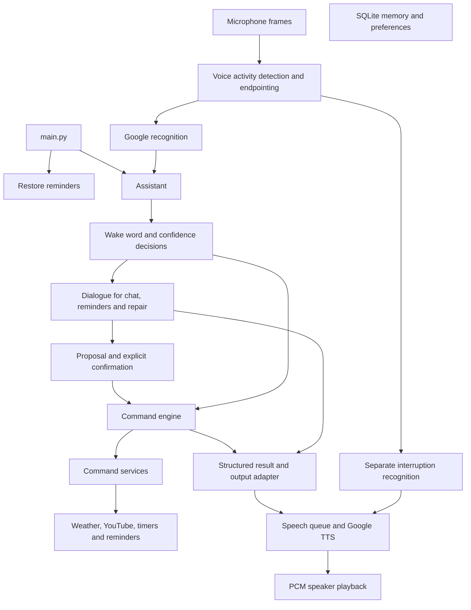

**Jarvis project audit — 6 October 2026**

Jarvis partially serves its stated purpose: it can answer local questions, call real cloud services, manage basic timers, and generate speech. It is a functional personal-assistant prototype, but it is not yet a dependable hands-free assistant. Ordinary language can select the wrong action, reminders can run at the wrong time or survive deletion, and the advertised persistent memory is disconnected from the application.

The strongest next step is to repair correctness and measure voice reliability before expanding features. The existing command boundary and injectable voice pipeline are useful foundations; a complete rewrite is unnecessary.

This assessment uses the README's goal of a voice-controlled personal assistant. No further product requirements were supplied during the audit. Existing uncommitted changes were preserved. This report is the only project file added by the audit.

The project contains 57 Python files and 8,644 Python source lines, including tests and experiments. The inventory and syntax scan covered all of those files; deeper review traced the active application paths and their supporting modules.

The structure is as follows:

| Area | Responsibility | Assessment |
| --- | --- | --- |
| `main.py`, `core/assistant.py` | Startup, passive/active conversation, dispatch and shutdown | Working orchestration, with blocking command execution and multiple conversation states |
| `core/voice_capture.py`, `voice_runtime.py`, `voice_recognition.py`, `voice_policy.py` | Continuous PCM input, VAD, cloud recognition, confidence and interruption policy | Well separated and testable; live reliability still needs measurement |
| `core/command_engine.py`, `command_services.py`, `command_result.py`, `command_output.py`, `intent_handler.py` | Parse, execute, return structured results, deliver foreground/background output | Strong foundation; parsing and success contracts need repair |
| `core/dialogue.py`, `conversation_context.py`, `chatgpt_service.py` | Conversational repair, confirmations, follow-ups and model calls | Three separate forms of conversation state produce inconsistent behavior |
| `core/speech_synthesis.py`, `speech_output.py`, `utils/audio_utils.py` | Google TTS, queued synthesis, PCM playback and cancellation | Real synthesis works; serial generation and playback add delay |
| `core/reminder_manager.py`, `smart_timer.py`, `timer_alerts.py` | Scheduling, timers, recurrence and notifications | Basic paths work; several lifecycle and persistence defects |
| `core/weather_service.py`, `youtube_service.py` | External information and video search | Providers reachable; parsing, deadlines and error reporting need improvement |
| `core/memory_manager.py`, `data/` | SQLite history/preferences and JSON scheduling/history files | Database readable, but memory/preferences are not connected to the live assistant |
| `utils/nlp_utils.py` | Broad NLP toolkit; reminder extraction uses a transformer pipeline | Large module and a costly first import for a narrow active use case |
| `tests/` | Seven isolated test modules | 145 tests pass |
| Root `test_*.py`, `full_test.py`, backup modules, legacy timer/scheduler utilities | Experiments and older implementations | Several have import-time side effects; they are not the production path |
| `config/`, `requirements.txt`, `docs/`, `logs/` | Configuration, installation, architecture notes and diagnostics | Works on this computer; portability and reproducibility need attention |

The active flow is:



The disconnected SQLite node is intentional: production code does not call the memory manager. Cloud recognition also runs before the passive wake-word check; the current wake check is a check of recognized text, not a local wake-word detector.

The checks performed produced these results:

| Check | Result | What it establishes |
| --- | --- | --- |
| `env\Scripts\python.exe -B -m pytest tests -q -p no:cacheprovider` | **145 passed in 3.19 seconds** | Isolated command, adapter, dialogue, logging, voice-policy and playback behavior |
| AST syntax scan | All 57 Python files parse | No Python syntax errors; not a guarantee of successful imports or behavior |
| `pip check` | No broken installed requirements | Installed dependency metadata is internally consistent |
| Declared dependency comparison | 139 requirement entries; installed `google-cloud-speech` is 2.28.1 versus pinned 2.28.0 | The current environment is slightly different from the manifest |
| `main` import | Approximately 19 ms in one fresh process | Importing the entry point is lightweight; this excludes microphone startup and provider work |
| Actual reminder NLP import | Successful; approximately **14.09 seconds** | The model is installed here, but first reminder use can block the command loop |
| Google credential loading | Successful; configured external file exists | The hardcoded path works here |
| SQLite read-only `PRAGMA quick_check` | `ok`; 260 conversation rows, no preference/session rows | Existing storage is readable; does not establish application integration |
| OpenWeatherMap current-weather requests | HTTP and HTTPS both returned 200 | Configured weather key/provider works for Kokkola |
| YouTube search request | HTTP 200 | Configured provider/key can search; browser playback was not exercised |
| Actual OpenAI dialogue call | Valid `reply`/`query` JSON, no action proposal | Current model/API configuration works for one simple conversational request |
| Actual Google TTS synthesis | 77,438 PCM bytes, mono, 24 kHz | Speech generation works; no audio was played during this check |
| Audio-device enumeration and format checks | Default 16 kHz input and 24 kHz output accepted | Device configuration is supported; recording quality and simultaneous input/output were not tested |
| Legacy `full_test.py`, isolated in temporary storage with chat stubbed | **4 passed, 4 failed** | Location-setting, cross-session location, hourly climate and preference workflows are missing from the current path |

Provider probes were small authenticated requests. Their observed process wall times were approximately 0.26 s for weather, 0.54 s for YouTube, 3.50 s for OpenAI dialogue, and 1.99 s for TTS; these include imports/client initialization where applicable and are not end-to-end voice benchmarks. The legacy suite was intentionally run with a temporary database and stubbed chat so it could not modify the real memory database. Browser actions in its relevant test were mocked by the test itself.

A further six-query experiment used the real reminder extractor with each installed spaCy model, in separate processes and without changing project code. Median extraction time was 40.1 ms with `en_core_web_sm` and 84.6 ms with `en_core_web_trf`; the slowest query took roughly 1.4–1.5 seconds with either model because of fallback date parsing. Both lost explicit dates, and both extracted the word `me` as the time in “remind me to take a break in one hour.” The small model also missed Alice as a person entity, although the task text retained her name. This small concurrent benchmark supports simplifying the parsing path, but it is not enough evidence for an unconditional model replacement.

The following feature assessment distinguishes implemented behavior from advertising:

| Feature | Current status |
| --- | --- |
| Current time, today's/tomorrow's/yesterday's date | Working for the tested phrases |
| Day after tomorrow | Wrong date: the tomorrow branch runs first |
| Wake and active conversation | Implemented and covered by isolated tests; microphone accuracy not established |
| Interruptible speech | Queue/cancellation logic is tested; real stop latency and speaker echo behavior remain unverified |
| General voice chat | Real dialogue provider works; ordinary questions can be misrouted before reaching it |
| Basic named timers, pause/resume/cancel/status, Pomodoro work-to-break chain | Tested for standard cases; additional control and lifecycle defects below |
| One-time reminders | Can be created and delivered; date extraction, identity and cancellation are unreliable |
| Recurring reminders | Partial implementation; restoration and interval semantics have defects |
| List/delete/snooze reminders by voice | Current routing does not expose these as dependable operations |
| Weather and forecast | Real current-weather access works; normal city/date phrasing can generate an invalid city; forecast rendering reviewed but not live-probed |
| YouTube | Real search works; opens a URL rather than providing pause/volume/playback control |
| Web search | Only opening Google is implemented; no general search-results workflow |
| Long-term memory and persistent preferences | Storage helpers exist; production integration is absent |
| Alarm | Classified but has no execution branch; falls through to chat |
| Climate/room monitoring | HTTP helpers and Socket.IO experiments exist; no production integration or server in this repository |
| Health/status | Fixed response claiming all systems are operational; no health checks |

The most important defects, their causes, and repairs are below. “Reproduced” means the current code was exercised with controlled clocks, temporary storage or injected services. “Code inspection” identifies a structural failure or risk without claiming a live failure occurred.

| Priority | Finding and evidence | Cause and proposed repair |
| --- | --- | --- |
| **P1** | **Reminder dates are discarded.** Reproduced the actual time-extractor function at a fixed 6 October, 10:00: “tomorrow at 9 pm” becomes 6 October, 21:00; “next Monday at 9 am” and “December 20 at 9 am” become 7 October, 09:00. `utils/nlp_utils.py:244`, `core/command_engine.py:70`, `core/reminder_manager.py:43`. | Time-only regex matches win before date phrases. The extracted parsed datetime is then ignored and the shortened string is parsed again by the scheduler. Parse one complete date/time expression once, retain the original text and timezone, and pass the resolved datetime through confirmation and execution. Ask about ambiguity rather than choosing silently. |
| **P1** | **Deleting/snoozing a reminder does not cancel its original alert.** Reproduced deletion followed by invocation of the original scheduled callback: it still announces the reminder. `core/reminder_manager.py:71`, `:135`, `:142`. | `threading.Timer` is not retained, and deletion only edits JSON. Store handles and persistent reminder IDs, cancel/replace jobs by ID, and have callbacks recheck current state before notifying. Cancellation alone cannot prevent a callback that has already begun, so the state check matters. See [Python Timer behavior](https://docs.python.org/3/library/threading.html#timer-objects). |
| **P1** | **Recurring reminders disappear after restarting once their original date has passed.** Reproduced an uncompleted daily reminder from two days earlier: no recurring job was restored. `core/reminder_manager.py:28`. | The future-date condition encloses both one-time and recurring restoration. Restore recurrence from its rule regardless of the original occurrence; calculate the next occurrence and define handling for missed events. The current data also contains two past, uncompleted one-time reminders; they remain stored but are not rescheduled. |
| **P1** | **Reminder listing/removal enters creation routing.** “What are my reminders” was reproduced as a pending new reminder. `core/intent_classifier.py:4`, `core/command_engine.py:16`. | Any `remind` substring selects creation before the list branch. Add distinct list/create/delete/snooze intents, match the operation before generic nouns, and connect them to services using IDs or explicit target selection. |
| **P1** | **Names are used as reminder identity.** Reproduced completing one “same name” reminder marking both same-name entries complete. `core/reminder_manager.py:107`. | Completion scans by task text. Use immutable IDs and update exactly one scheduled instance. |
| **P1** | **Timer commands can control the wrong timer.** Reproduced “unpause pasta timer” selecting pause; requesting cancellation of a nonexistent label cancelled the only existing Pasta timer. `core/smart_timer.py:910`, `:679`; similar fallback in pause/resume/add-time. | Substring order matches `pause` inside `unpause`; failed explicit labels fall back to the only timer. Match complete control phrases and permit sole-timer fallback only when no target was supplied. |
| **P1** | **Ordinary queries trigger unrelated commands.** Reproduced “update my preference” returning today's date and “explain runtime errors” returning the time. “Continue explaining” selects the timer route. `core/intent_classifier.py:1`. | Broad substring classification and control words take priority over conversation. Use anchored command patterns/token boundaries and a typed intent/argument schema. Keep uncertain interpretation separate from execution. |
| **P1** | **Weather city names are corrupted.** Reproduced Helsinki → `helski`, Washington → `washgton`, Athens → `hens`; the README's “what's the weather like today?” produces city `like today`. `core/command_engine.py:29`. | Sequential string replacement removes `in`, `at`, `the` inside city names and leaves other sentence fragments. Extract the city as a span and parse requested day separately. Use the configured/default location only when no city was given. |
| **P1** | **Blocking network work can stall foreground handling.** Code inspection: active weather requests omit timeouts; YouTube uses an unconfigured transport timeout; legacy text-chat calls omit an application-specified deadline. `core/weather_service.py:183`, `:327`, `core/youtube_service.py:14`, `core/chatgpt_service.py:70`. | Capture continues, but `Assistant.process_recognition` synchronously executes services/model work. Add explicit transport timeouts and command deadlines, run long work outside the conversation event loop, and discard superseded results by request ID. Requests has no timeout when omitted; a connect/read timeout is also not a total command deadline. See [Requests documentation](https://requests.readthedocs.io/en/latest/user/quickstart/#timeouts). |
| **P1** | **Memory and preferences are advertised but disconnected.** Repository references show no production caller of `core.memory_manager`; the legacy feature tests fail. | Persist completed exchanges, read preferences into settings, and retrieve a small relevant history for dialogue. Do not simply send all stored conversations to the model. Until connected and tested, describe memory as unfinished. |
| **P2** | **Voice follow-ups bypass the deterministic context handler.** Reproduced forecast → “yes” producing “What would you like me to do?” with no weather lookup. `core/assistant.py:87`, `core/dialogue.py:60`. | Chat-classified follow-ups enter Dialogue before `CommandServices.follow_up`. Unify dialogue/context state and give pending confirmations and known follow-ups explicit precedence. `conversation_context.py:104` also rejects “tell me more” as a new query before its own more-details branch. |
| **P2** | **Suggested timers start before consent.** Reproduced “set a tea timer” asking “Is that okay?” while creating a three-minute timer immediately. `core/smart_timer.py:429`. | There is no actual pending-confirmation transition. Return a structured proposal, then create only after confirmation, or ask for duration. Confirm the resolved duration, not merely the ambiguous command text. |
| **P2** | **Duration parsing is incomplete.** Reproduced “twenty five minutes” as five minutes and a negative five-minute request as positive five minutes. `core/smart_timer.py:168`. | Written numbers are handled individually and the numeric regex ignores signs. Parse compound numbers, validate signs/ranges, and reject unsupported durations. |
| **P2** | **Failures can look successful.** Reproduced a failing weather provider message returning `status='handled'` and `webbrowser.open=False` still producing “Opening Google.” `core/command_engine.py:81`, `:107`, `:110`. | Provider error strings and ignored browser return values blur delivery/dispatch/success. Have providers return structured outcomes and use explicit failure status. Replace the fixed “all systems operational” response with actual capability health. |
| **P2** | **Timer timing/persistence/lifecycle is fragile.** Code inspection: elapsed duration uses `datetime.now`; active timers are not saved; each timer has a daemon worker; pause/resume reuses an event and starts another worker without joining the previous one. `core/smart_timer.py:79`, `:132`, `:495`, `:609`, `:643`. | Use a monotonic clock for elapsed durations, wall-clock timestamps with explicit timezone for persistence, and a single scheduler owning state transitions. Guard completion so it occurs once. Rapid pause/resume can leave overlapping workers; this risk was not stress-tested. [Python monotonic clock documentation](https://docs.python.org/3/library/time.html#time.monotonic) explains why it avoids system-clock changes. |
| **P2** | **Recurrence rules are incomplete.** Code inspection: weekly schedules start every seven days rather than preserving a requested weekday; hourly schedules use minute zero; monthly requests have no scheduling branch. `core/reminder_manager.py:91`. | Represent interval, weekday, time, timezone and next occurrence explicitly. Reject unsupported recurrence instead of announcing success after storing an unscheduled record. |
| **P2** | **Storage can fail or become inconsistent.** Code inspection: relative `data/` paths, direct JSON rewrites and no reminder-state lock. Reproduced database-open failure becoming `UnboundLocalError` in three memory functions. `core/memory_manager.py:5`, `:55`, `core/reminder_manager.py:37`. | Resolve storage against the project/user-data directory, initialize it explicitly, validate schemas and use transactions. Prefer SQLite for schedules; if retaining JSON, write a temporary file and replace atomically under a lock. Use connection context managers or initialize `conn=None` before error handling. |
| **P2** | **Voice and diagnostic lifecycle needs resilience.** Code inspection: microphone failure terminates the runtime; queue replacement drops older work without drop events; TTS failures remain on jobs callers do not inspect; scheduled managers are not stopped by `Assistant.close`. | Add device reconnection/backoff, explicit queue-drop events, provider/error state visible to the user, and unified service shutdown. Protect notification workers from an output-queue failure killing future processing. |

The existing voice log adds practical evidence, but it does not establish a current accuracy score. It contains three sessions from **10 September 2026**, before this audit, with 385 valid events. Their exact code version and the user's intended speech are not recorded.

| Observation in that log | Meaning |
| --- | --- |
| 49 final recognition results; 35 `unrecognized`, 14 without errors | Many recordings did not produce a transcript; silence/noise/echo may be included, so this is not a word-error-rate measurement |
| 17 clarification decisions, 2 accepted command decisions, 2 wake decisions | Considerable interaction friction in the recorded sessions; not a success rate for all intended tasks |
| 19 results filtered as unaddressed during playback | Speaker overlap or user speech during output was being rejected; the log cannot distinguish them reliably |
| 21 speech jobs completed, none logged as failed | Output jobs completed in those sessions; this does not prove the user heard them correctly |
| 39 recorded recognition timings: median 515 ms, maximum 2,016 ms | Partial and final calls combined; only instrumented calls have timings |
| Five recorded synthesis timings: median 594 ms, maximum 860 ms | Small historical sample |
| Two playback waits for input: 922 ms and 5,594 ms | VAD/input gating can add several seconds beyond provider latency |

No acoustic echo cancellation exists in the current source. The implementation compares recognized text with output text, which can suppress echoes but cannot separate mixed microphone/speaker audio. Background speech or speaker echo can keep VAD active and delay the first playback of a response. These are plausible contributors to the observed waits; they are not proven causes without paired audio measurements.

To make execution smoother and more efficient, apply these changes in this order:

1. **Repair command and scheduling correctness.** Cover the exact reproductions above with meaningful regression tests. Separate reminder operations, preserve full datetime information, introduce schedule IDs/cancellation, repair recurring restoration, fix explicit timer targets, city extraction and the day-after-tomorrow branch. Ensure a confirmation describes the resolved action that will actually execute.

2. **Keep conversation handling responsive.** Move long provider calls into bounded workers with request identities and deadlines. Continue accepting stop/replacement requests, and prevent old replies from playing after a newer request. Capture and partial interruption already run independently, so build on that design. Add a short local acknowledgement only when a request is genuinely slow; avoid creating more queued speech for every turn.

3. **Reduce NLP cost.** Isolate reminder parsing from the 1,413-line general NLP toolkit. The active regex/date parsing should not require loading a transformer pipeline. Use deterministic extraction for ordinary commands and the existing dialogue model for ambiguity. Restrict accepted date segments and parsing language so ordinary words cannot become schedule times; support written relative durations explicitly. If entity recognition still needs spaCy, validate the small model and load only the components required by the accepted reminder corpus. Excluding unnecessary components can improve load/inference costs, but dependent components must be retained. See [spaCy pipeline guidance](https://spacy.io/usage/processing-pipelines#disabling). Moving the same heavy import to startup only shifts the delay; removing unnecessary work produces the real benefit.

4. **Measure and repair voice input before changing providers.** Use a headset first, pin the correct microphone, record intended phrases alongside event times, and compare with speakers. Tune VAD and silence endpointing from those results. A 1.4-second endpoint is an intentional latency floor; reducing it blindly will cut off pauses. Add an on-device wake-word gate with buffered pre-roll so passive background speech does not require cloud transcription. Run interruption recognition only when audio is actually audible: `voice_runtime.py:109` currently checks an active job ID, which also exists during silent synthesis/input waiting.

5. **Reduce output/network overhead.** Keep the shared output controller and short chunks. Add bounded next-chunk synthesis ahead of playback, cache common acknowledgements/chimes, reuse HTTP sessions, and cache weather briefly with its observation time. Prioritize completion alerts and expire stale milestone alerts; the current chimes share the speech queue and can wait behind a long response. `remaining_fn` is passed to milestone dispatch but is not consulted before output.

6. **Connect persistence deliberately.** Use one store for schedules and preferences, define restart/missed-event behavior, retain in-session dialogue in one state owner, and retrieve only relevant saved context. Conversation history, task records and diagnostic logs have different retention needs. Implement the promised memory/preferences workflow and retire the redundant initializer after migration.

7. **Make installation and operation repeatable.** Move the working but machine-specific Google credential path into environment configuration, explicitly configure timezone/city/devices, and provide a validated `.env.example` and startup health command. Separate runtime dependencies from experimental dependencies; the 139-entry file is effectively a frozen environment, including tools unused by `main`. The transformer model is installed manually through the README rather than the requirements manifest. Validate a clean Windows environment before claiming portable support.

8. **Clean up the development surface.** Move microphone/cloud/model-loading experiments out of pytest discovery or configure `testpaths=tests`. A bare `pytest` can import a Whisper model, cloud clients, a Socket.IO connection or the real database. Keep the old feature tests as explicit failing specifications until the feature decision is made. Exclude runtime database/reminder/history files from Git; they are currently untracked but not ignored. Rotate the transcript log, add queue/latency metrics, and update architecture/status claims. The README links an MIT `LICENSE` file that is absent.

Two inactive modules deserve particular care during cleanup: `utils/schedule_utils.py` has an unthrottled scheduler loop and starts another thread on each scheduling call; `core/timer_manager.py` is an older, separate implementation. Neither is imported by the active application. They are maintenance hazards, not explanations for current live CPU usage. Likewise, backups and broad NLP “features” are not evidence that the live assistant supports those capabilities.

A useful target structure keeps `Assistant` as a thin conversation coordinator, gives one session object ownership of dialogue/confirmation/context, retains the existing typed command boundary and provider adapters, and gives one scheduler ownership of durable task state. Speech capture/output remain separate workers. This removes duplicated state without discarding the working testable parts.

Before calling the product dependable, validate an agreed command corpus through text and real voice. Include ordinary wording, names/cities, negation, compound durations, explicit wrong targets, next-day/week/date requests, list/delete/snooze, recurrence, restart, offline providers, speaker overlap and rapid pause/resume. Test cancellation immediately before an alert fires and simultaneous reminders with identical task text.

Suggested acceptance targets are zero unintended actions in that corpus; every deleted/cancelled job stays cancelled; every supported schedule restores correctly; no unbounded provider wait; and at least 90% of ordinary quiet-room requests complete without a full repeat. Measure median and 95th-percentile speech-end-to-first-audio latency, clarification frequency, interruption latency, CPU/RAM during idle/active periods and queue drops. These are proposed targets, not results achieved by this project. An actual acoustic test and soak test remain necessary.

For the present checkout, use the known isolated test command and the project interpreter:

```powershell
.\env\Scripts\python.exe -B -m pytest tests -q -p no:cacheprovider
.\env\Scripts\python.exe main.py
```

The evidence supports retaining and improving this project as a personal voice-assistant prototype. Dependable reminders and smooth hands-free use require the correctness, lifecycle and voice-validation work above. Climate control, broad system automation and persistent personal memory are not currently delivered by the active product.
